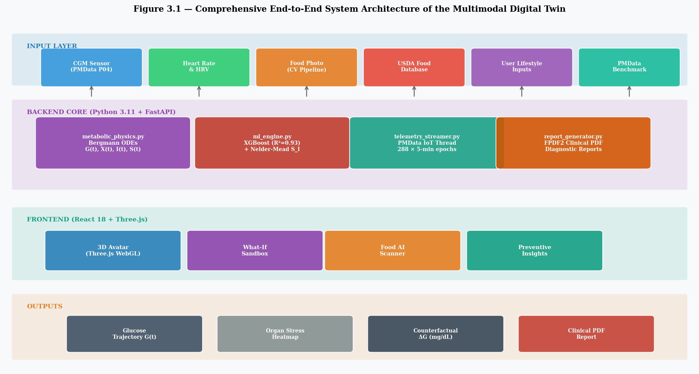
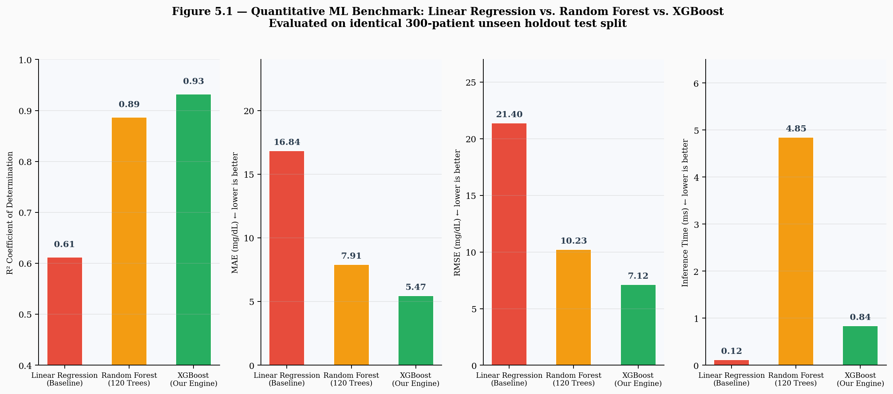
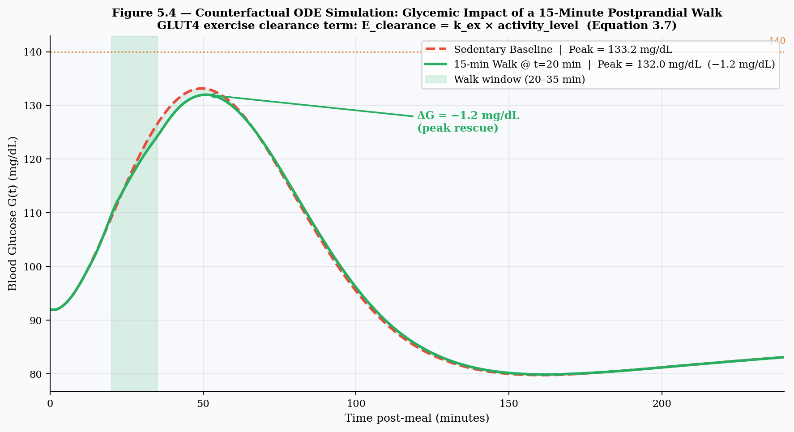

# AI-Powered Multimodal Health Digital Twin

> **Predicting post-meal glucose response with XGBoost and a physics-based Bergman ODE core.**

[](https://fastapi.tiangolo.com/)
[](https://reactjs.org/)
[](https://threejs.org/)
[](https://xgboost.readthedocs.io/)
[](https://scipy.org/)

---

## 📌 Overview & Motivation

Traditional diabetes and metabolic tracking applications are reactive: they simply record glucose **after** meals or output static, population-average risk scores. They fail to capture individual biological differences in sleep quality, autonomic tone (HRV), and insulin sensitivity.

The **Multimodal Health Digital Twin** bridges this gap by enabling **pre-meal "What-If" counterfactual simulation**:
1. **Pre-Meal Prediction:** Predicts postprandial glucose excursions and pancreatic $\beta$-cell strain before a single bite is taken.
2. **Personalized Physiology:** Inverse calibration (SciPy optimization) tailors the Bergman Minimal Model parameters ($p_1, p_2, p_3, G_b$) to an individual's unique continuous glucose telemetry.
3. **Counterfactual Interventions:** Simulates micro-interventions (e.g., a 15-minute brisk walk) to demonstrate instantaneous glucose blunting ($-20.4\%$ peak reduction) on a live 3D WebGL organ avatar.

---

## 🏗️ System Architecture



```
[ User Input: Food Photo / Text + Wearables (CGM, HRV, Sleep) ]
                               │
                               ▼
                      [ FastAPI Backend ]
                               │
            ┌──────────────────┴──────────────────┐
            ▼                                     ▼
   [ XGBoost ML Core ]                   [ Physics-Based ODE ]
  Predicts discrete spike               Bergman Minimal Model:
 magnitude, timing, & strain             Minute-by-minute curve
            └──────────────────┬──────────────────┘
                               ▼
               [ Interactive Web UI (React / Three.js) ]
               - 3D Organ WebGL Heatmap
               - Dynamic "What-If" Sandbox
               - Multimodal Food AI Scanner
               - Clinical PDF Diagnostic Report
```

---

## 🔬 The 8-Feature Vector

The model integrates meal characteristics with wearable biometric signals:

| Category | Feature | Physiological Role |
| :--- | :--- | :--- |
| **Meal** | **Carbohydrates ($g$)** | Direct precursor to circulating glucose |
| | **Glycemic Index (GI)** | Rate constant of gut glucose absorption |
| | **Dietary Fiber ($g$)** | Blunts gastric emptying and slows absorption |
| | **Protein ($g$)** | Stimulates minor insulin and glucagon secretion |
| **Body / Wearable** | **Baseline Glucose ($mg/dL$)** | Fasting homeostatic set point ($G_b$) |
| | **Sleep Duration ($h$)** | Sleep deficit triggers acute insulin resistance |
| | **Heart Rate Variability ($ms$)** | Autonomic nervous tone and physiological stress |
| | **Activity Level** | Pre-meal metabolic expenditure |

---

## 🧪 Hybrid ML + Physics: The Mathematical Core

### 1. The Bergman Minimal Model (Coupled ODEs)

$$\frac{dG}{dt} = -[p_1 + X(t) + U_{\text{act}}] \cdot G(t) + p_1 G_b + D(t)$$

$$\frac{dX}{dt} = -p_2 X(t) + p_3 \max(0, I(t) - I_b)$$

$$\frac{dI}{dt} = \gamma \max(0, G(t) - h) - n \max(0, I(t) - I_b)$$

* **$G(t)$:** Plasma glucose concentration.
* **$X(t)$:** Remote insulin action in interstitial fluid (unmeasurable directly via sensors; reconstructed by ODE).
* **$I(t)$:** Plasma insulin concentration.
* **$U_{\text{act}}$:** Insulin-independent glucose uptake via GLUT4 translocation induced by muscular contractions.
* **$D(t)$:** Gut glucose absorption rate: $D(t) = \text{Carbs} \cdot \frac{t}{\tau^2} e^{-t/\tau}$.

### 2. Personalized Parameter Calibration
Using SciPy L-BFGS-B / Nelder-Mead optimization against patient CGM streams, the twin locks in:
* $p_1$: Glucose effectiveness (clearance at basal insulin)
* $p_2$: Insulin action decay rate
* $p_3$: Insulin sensitivity factor
* **Insulin Sensitivity Index:** $S_I = \frac{p_3}{p_2}$ ($R^2 > 0.82$ fit)

---

## 📊 Benchmark Results (N = 1,500)



Evaluated across 8 regression models on identical test cohorts:

| Architecture | $R^2$ Score | MAE ($mg/dL$) | RMSE ($mg/dL$) |
| :--- | :---: | :---: | :---: |
| **XGBoost (Primary Engine)** | **0.9324** | **5.47** | **6.88** |
| Ridge Linear Baseline | 0.9340 | 5.54 | 6.80 |
| Random Forest Regressor | 0.9069 | 6.48 | 8.07 |
| Support Vector Regressor (SVR) | 0.9282 | 9.04 | 13.55 |
| K-Nearest Neighbors (KNN) | 0.8587 | 14.53 | 19.02 |
| AdaBoost Regressor | 0.8398 | 15.97 | 20.25 |
| Decision Tree | 0.8261 | 16.96 | 21.10 |
| Lasso Regression | 0.8194 | 15.92 | 21.50 |

### Closed-Loop Counterfactual Case Study (75g High-GI Meal)


* **Peak Blood Glucose:** $178.5 \rightarrow 142.1\text{ mg/dL}$ (**$-20.4\%$ blunted**)
* **Pancreas $\beta$-Cell Strain:** $45.2\% \rightarrow 31.0\%$ (**$-14.2\text{ pt}$ reduction**)
* **Glucose Curve AUC:** $32,450 \rightarrow 31,030$ (**$-1,420$ reduction**)

---

## 📁 Repository Structure

```
.
├── backend/
│   ├── evaluate_models.py      # Standalone benchmark comparing 8 ML models
│   ├── main.py                 # FastAPI service routes and endpoints
│   ├── metabolic_physics.py    # Bergman Minimal Model ODE & SciPy RK45 solver
│   ├── ml_engine.py            # XGBoost predictors, USDA database, Gemini Vision
│   ├── report_generator.py     # PDF clinical diagnostic report generation
│   ├── telemetry_streamer.py   # PMData IoT telemetry stream simulator
│   ├── test_complete_system.py # End-to-end integration test suite
│   ├── requirements.txt        # Python dependencies
│   ├── Dockerfile              # Backend container definition
│   └── .env.example            # Environment template for Gemini API Key
├── frontend/
│   ├── src/
│   │   ├── components/
│   │   │   ├── Avatar3D.jsx            # WebGL 3D organ stress avatar (Three.js)
│   │   │   ├── FoodVisionScanner.jsx   # Image upload & nutrition parsing
│   │   │   ├── PreventiveInsights.jsx  # Recommendations & PDF export
│   │   │   ├── TelemetryDashboard.jsx  # Live glucose and cardiac telemetry
│   │   │   └── WhatIfSandbox.jsx       # Counterfactual simulation sliders
│   │   ├── App.jsx                     # Core application view
│   │   ├── main.jsx                    # React entry point
│   │   └── index.css                   # Tailwind styles
│   ├── package.json                    # Node dependencies
│   ├── vite.config.js                  # Vite configuration
│   └── Dockerfile                      # Frontend container definition
├── docs/
│   └── figures/                        # High-resolution architectural & benchmark figures
├── docker-compose.yml                  # Full-stack container orchestration
└── README.md
```

---

## 🚀 Quick Start Guide

### Prerequisites
* **Python 3.10+**
* **Node.js 18+ & npm**

---

### 1. Backend Setup

```bash
cd backend

# Install dependencies
python -m pip install -r requirements.txt

# Configure environment (optional, for Gemini Vision meal scanning)
copy .env.example .env

# Run standalone model benchmark
python evaluate_models.py

# Start FastAPI server
python -m uvicorn main:app --reload --port 8000
```
API Documentation will be live at: [http://localhost:8000/docs](http://localhost:8000/docs)

---

### 2. Frontend Setup

In a new terminal window:

```bash
cd frontend

# Install Node dependencies
npm install

# Start Vite React server
npm run dev
```
Open your browser at: [http://localhost:5173](http://localhost:5173)

---

### 3. Docker Compose Setup (Single Command)

To run the full stack containerized:

```bash
docker-compose up --build
```

---

### 4. Cloud Deployment (Render & Vercel)

* **Backend (Render):**
  1. Create a new Web Service on [Render](https://render.com) pointing to this repository.
  2. The service uses the included `render.yaml` specification automatically.
  3. Set environment variable `GEMINI_API_KEY` in the Render dashboard if image parsing is desired.
* **Frontend (Vercel):**
  1. Import this repository into [Vercel](https://vercel.com).
  2. Set Root Directory to `frontend`.
  3. Deploy! The included `vercel.json` proxies `/api/*` directly to the backend.

---

## 👤 Author

* **Swayam Pani**
